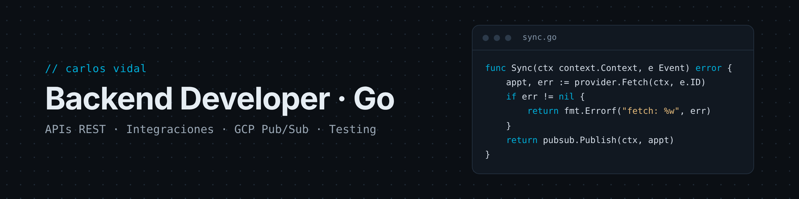

<div align="center">
  
</div>

<h1 align="center">
  <a href="https://git.io/typing-svg"></a>
</h1>

<p align="center">
  <a href="https://www.linkedin.com/in/carlosvidaldev"></a>
  <a href="mailto:carlosvidal.developer@gmail.com"></a>
  
</p>

## 🚀 Sobre mí

```go
type Developer struct {
	Name     string
	Role     string
	Company  string
	Focus    []string
	Learning []string
}

var carlos = Developer{
	Name:     "Carlos Vidal",
	Role:     "Integration Developer (Go)",
	Company:  "Top Doctors · sector salud",
	Focus:    []string{"APIs REST", "Webhooks", "GCP Pub/Sub", "Testing"},
	Learning: []string{"Sistemas distribuidos", "Mensajería", "Observabilidad"},
}
```

Desarrollo integraciones en Go entre la plataforma de **Top Doctors** y sistemas externos del sector salud: aseguradoras, hospitales, software de gestión clínica y diagnóstico por imagen. El código de mi trabajo es privado; aquí están mis proyectos personales.

## 💼 Lo que hago

| | |
|---|---|
| 🔌 **+10 integraciones** | Con APIs de terceros: datos maestros y ciclo completo de citas (disponibilidad, creación, cancelación y reprogramación) |
| 📨 **Procesamiento asíncrono** | Eventos con GCP Pub/Sub, enrutado por integración y handlers por proveedor |
| 🗂️ **Pipeline de datos** | Ingesta semanal de un catálogo público de medicamentos: XML → modelo relacional → API HTTP |
| 🧪 **Código testeado** | Servicios por capas (handlers, servicios, repositorios, mappers) con tests unitarios y mocks |

## ⭐ Proyecto destacado

<table>
<tr>
<td>

### [Acelerik Booking](https://github.com/cvidaal/acelerik-demo)
**API de reservas y pagos en Go** para parques infantiles.

- API REST con **Gin + Huma** y documentación **OpenAPI** generada
- **PostgreSQL** con **pgx** y máquina de estados de reservas validada
- **Stripe Checkout + webhooks**, con `SELECT … FOR UPDATE` para evitar pagos duplicados
- Tests table-driven, **Docker Compose** y **CI con GitHub Actions**

[](https://github.com/cvidaal/acelerik-demo/actions/workflows/backend.yml)

</td>
</tr>
</table>

## 🛠️ Tech stack

<p align="center">
  
  
  
  
  
  
  
</p>

<p align="center"><sub>También he trabajado con</sub><br/>
  
  
  
  
  
</p>

## 📊 GitHub stats

<p align="center">
  
  
</p>

<p align="center">
  
</p>

<p align="center">
  
</p>

## 📫 Contacto

<p align="center">
  ¿Hablamos de Go, backend o integraciones? 👇<br/><br/>
  <a href="https://www.linkedin.com/in/carlosvidaldev"></a>
  <a href="mailto:carlosvidal.developer@gmail.com"></a>
</p>
